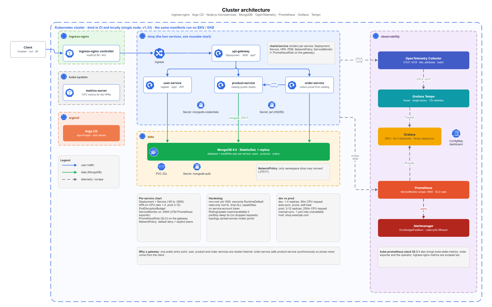
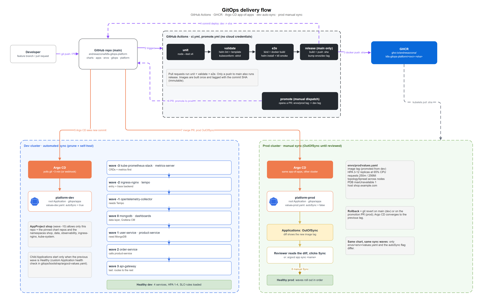
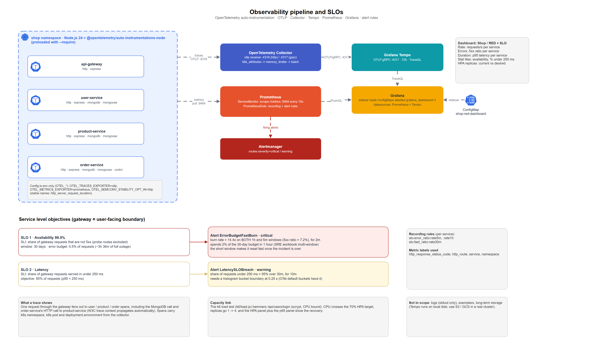

# k8s-gitops-platform

A small shop (four Node.js microservices + MongoDB) delivered to Kubernetes the GitOps way: one reusable Helm chart, Argo CD app-of-apps with sync waves, OpenTelemetry traces and metrics into Tempo and Prometheus, SLO alerts, and k6 tests, all validated in CI on an ephemeral kind cluster.


[](https://github.com/andresazcona/k8s-gitops-platform/actions/workflows/ci.yml)







Editable sources: [`docs/diagrams/k8s-gitops-platform.drawio`](docs/diagrams/k8s-gitops-platform.drawio) (3 pages) generated by [`gen_drawio.py`](docs/diagrams/gen_drawio.py).

## Problem and goals

Show what a production-minded delivery platform looks like without renting a cloud: everything runs on a throwaway kind cluster, in CI and on a laptop.

- One chart, many services: adding a service is a 20-line values file, not a copy of 8 manifests.
- Git is the only way to change a cluster: Argo CD reconciles; dev follows `main`, prod needs a human.
- Observability is not an afterthought: RED dashboard, traces, and alerts tied to explicit SLOs ship with the platform.
- Everything is verified before it merges: lint, schema validation, unit tests, a real install on kind, and a k6 smoke test.

## The workload

The services come from my own study [architecture-comparison](https://github.com/andresazcona/architecture-comparison) (monolith vs microservices e-commerce, MIT). Only the microservices were taken, in `apps/`. The originals were skeletons (missing handlers, a gateway pointing at the wrong ports), so each one now has real handlers backed by MongoDB, JWT auth, health endpoints, graceful shutdown and `node:test` tests.

| Service | Port | Depends on | Notes |
|---|---|---|---|
| `api-gateway` | 3000 | the three services below | Stateless reverse proxy for `/api/users`, `/api/products`, `/api/orders`; only workload behind the Ingress |
| `user-service` | 3000 | MongoDB (`users`) | Register, login (scrypt password hashing), issues HS256 JWTs |
| `product-service` | 3000 | MongoDB (`products`) | Public reads, JWT-protected writes |
| `order-service` | 3000 | MongoDB (`orders`), `product-service` | Prices orders by calling the catalog synchronously |

Env contract: `PORT`, `MONGODB_URI`, `JWT_SECRET`, `PRODUCT_SERVICE_URL`, `USER_SERVICE_URL`, `ORDER_SERVICE_URL`, plus `OTEL_*`. There is no queue; MongoDB is the only data store.

## Architecture walkthrough

1. **Entry.** ingress-nginx terminates HTTP and routes everything to `api-gateway`. The other services have no Ingress and a default-deny NetworkPolicy that only admits the gateway (and `order-service` for the catalog).
2. **Chart.** `charts/service` renders Deployment, Service, HPA, PodDisruptionBudget, NetworkPolicy, ServiceMonitor and (when `slo.enabled`) a PrometheusRule. Values layer as `charts/service/values.yaml` -> `apps/<svc>/values.yaml` (identity: image, env, peers) -> `envs/<env>/values.yaml` (sizing).
3. **Data.** MongoDB runs as a single-replica StatefulSet in namespace `data` with a database and a `readWrite` user per service. Only namespace `shop` can connect.
4. **GitOps.** `gitops/bootstrap/root-<env>.yaml` is the only thing applied by hand. It renders `gitops/apps` (a Helm chart) into one Argo CD Application per add-on, per kustomize directory and per service, ordered by sync wave (see diagram 2). A custom health check on the Application kind makes waves wait for the previous wave to be Healthy.
5. **Telemetry.** The Node services preload `@opentelemetry/auto-instrumentations-node` and are configured only with `OTEL_*` env vars. Traces go over OTLP to the OpenTelemetry Collector (adds Kubernetes metadata) and on to Tempo. Metrics are exposed by the OTel Prometheus exporter on `:9464` and scraped by Prometheus through the ServiceMonitor; they do not go through the Collector (one hop less to break). Grafana gets a Prometheus and a Tempo datasource and a provisioned RED dashboard.

### SLOs and alerts

Defined on the gateway, the user-facing boundary (`slo.enabled: true` in `apps/api-gateway/values.yaml`). Probe routes (`/healthz`, `/readyz`) are excluded.

| SLO | Objective | Alert | Condition |
|---|---|---|---|
| Availability | 99.5% of requests are not 5xx over 30 days (error budget 0.5%, about 3h36m of full outage) | `ErrorBudgetFastBurn` (critical) | 5xx ratio above 14.4 x 0.5% = 7.2% on both the 1h and 5m windows, for 2m. A 14.4x burn spends 2% of the monthly budget per hour |
| Latency | 95% of requests under 250 ms | `LatencySLOBreach` (warning) | Share of requests under 250 ms below 95% over 30m, for 10m |

Burn-rate math follows the multi-window pattern of the Google SRE workbook; the short window makes the alert reset quickly after recovery. The latency SLI needs a histogram bucket exactly at `0.25`, which the OTel default buckets include (`slo.latencySeconds` must stay on a bucket boundary). Metric names were checked against a running instance: `http_server_request_duration_{count,bucket}` with `http_route`, `http_response_status_code` (enabled by `OTEL_SEMCONV_STABILITY_OPT_IN=http`).

### k6

- `k6/smoke.js` (used by CI): register, login, create product, create an order priced by the catalog, read it back, and check a 401 without a token. Thresholds: all checks pass, zero failed requests, p95 under 1.5 s.
- `k6/load.js` (HPA demo): ramps to 40 virtual users calling `/api/users/login`. Login hashes with scrypt, so each request burns real CPU and pushes `user-service` past the 70% HPA target.

```bash
scripts/up.sh                         # or OBS=1 scripts/up.sh to include Prometheus/Grafana/Tempo
k6 run k6/load.js &
kubectl get hpa -n shop -w            # replicas climb from 1 towards 4 (dev), then settle back after the ramp-down
```

With `OBS=1`, the dashboard's "HPA replicas" and p95 panels show the same event (`kubectl -n observability port-forward svc/kube-prometheus-stack-grafana 3000:80`).

## Key decisions

- **One chart for every service.** Trade-off: the chart is opinionated (HTTP service, one container, OTel Prometheus port); a worker or cron job would need a second chart. Four identical services justify one; I did not generalize further.
- **App-of-apps as a Helm chart (`gitops/apps`) rather than an ApplicationSet.** The list of services, add-ons and waves is plain data in one `values.yaml`, and `helm template` + kubeconform can validate the exact Applications Argo CD will create. An ApplicationSet would shorten the template but hides the output from CI.
- **Auto-sync with prune and self-heal in dev, manual in prod.** Prod Applications are created by the same chart but with `autoSync: false`, so a merged promotion PR shows `OutOfSync` and waits for a human. Cost: one click per release; benefit: a reviewed diff at the moment of rollout.
- **CI commits the image tag to git (`envs/dev`) instead of using an image updater.** Fewer moving parts, and the deployed version is always readable in git. The bump uses `GITHUB_TOKEN`, so it does not re-trigger CI.
- **Immutable SHA tags, `IfNotPresent`.** No `latest`. The chart refuses to render without `image.tag`.
- **No CPU limits, memory limits yes.** CPU limits throttle Node (CFS) and distort the HPA; memory limits keep a leaking pod from taking the node.
- **Metrics scraped, traces pushed.** Prometheus pull via ServiceMonitor is the standard, cheap path; only traces need the Collector. Trade-off: two config surfaces (OTLP endpoint and scrape port).
- **MongoDB as a plain StatefulSet.** Good enough to demonstrate data-layer ordering, secrets and NetworkPolicy. It is a single replica without backups; a real cluster would use a managed database or an operator.
- **Secrets are created out of band** (`scripts/secrets.sh`) and never in git. A real cluster would use External Secrets or Sealed Secrets; the manifests only reference Secret names.
- **Tempo single-binary chart.** The `grafana/tempo` chart is marked deprecated upstream; it still runs Tempo 2.9 and is the lightest option for a single node. Production would use `tempo-distributed` with object storage.
- **CI uses no cloud credentials.** The only write paths are GHCR (`GITHUB_TOKEN`) and git. The repository needs "Read and write permissions" for workflows, and the GHCR packages must be made public for the cluster to pull without an image pull secret.

## Repo layout

```
apps/                    service code (from architecture-comparison) + apps/<svc>/values.yaml (identity)
  Dockerfile             one multi-stage, non-root image recipe for all services
charts/service/          the reusable chart
envs/{dev,prod}/         per-environment sizing (replicas, HPA, resources, image tag, host)
gitops/
  apps/                  app-of-apps chart (Applications + AppProject), values-dev/prod.yaml
  bootstrap/             Argo CD install values and the two root Applications
platform/                add-on values (kube-prometheus-stack, ingress-nginx, metrics-server, tempo,
                         opentelemetry-collector) and kustomize dirs (mongodb, dashboards)
k6/                      smoke.js, load.js
kind/kind-config.yaml    single node, ports 80/443 mapped to localhost
scripts/                 validate.sh, up.sh, secrets.sh, lib.sh
docs/diagrams/           .drawio, generator and PNGs
.github/workflows/       ci.yml (unit, validate, e2e, release), promote.yml
```

## Validate and run locally

Static validation (needs `helm`, `kubectl`, `kubeconform`; no cluster, no Docker):

```bash
scripts/validate.sh
```

It runs `helm lint --strict` on the chart and the app-of-apps, then `helm template` for every service and add-on in both environments (add-ons are pulled at their pinned versions) and the kustomize directories, piping each to `kubeconform -strict -summary`. CRDs (ServiceMonitor, PrometheusRule, Argo CD Application, ...) are validated against the datree CRD catalog, not skipped. Result on my machine: every stage reports `Invalid: 0, Errors: 0, Skipped: 0` (for example 8 resources for the gateway, 109 for kube-prometheus-stack). Unit tests: `npm test` in each `apps/<svc>` (13 tests, none need MongoDB).

Full local cluster (needs Docker, kind, kubectl, helm, openssl, k6):

```bash
scripts/up.sh                 # kind + ingress + MongoDB + 4 services, then:
k6 run k6/smoke.js
OBS=1 scripts/up.sh           # adds kube-prometheus-stack, Tempo, OTel Collector, dashboard
kind delete cluster --name shop
```

With Argo CD instead of `up.sh` (images must exist in GHCR, i.e. after the first `release` run):

```bash
scripts/secrets.sh
helm install argocd argo-cd --repo https://argoproj.github.io/argo-helm --version 10.10.3 \
  -n argocd --create-namespace -f gitops/bootstrap/argocd-values.yaml
kubectl apply -n argocd -f gitops/bootstrap/root-dev.yaml     # prod: root-prod.yaml
```

What the CI e2e job does (`ci.yml`): `helm/kind-action` creates the cluster from `kind/kind-config.yaml`, `scripts/up.sh` builds the four images, `kind load`s them, installs ingress-nginx, MongoDB and the services with `--wait`, then `k6 run k6/smoke.js` runs against `http://localhost` through the Ingress. A failed run dumps pods, descriptions and logs.

## What a managed cluster would cost

Not deployed. List prices, on-demand, approximate monthly, 730 h, one small HA-ish prod cluster (3 nodes of 2 vCPU / 4 GB: enough for the 4 services at 3 replicas, MongoDB, and the observability stack with 7-day retention). Excludes data transfer, taxes and discounts.

| Item | EKS (us-east-1) | GKE Standard (us-central1) |
|---|---|---|
| Control plane | 1 cluster x $0.10/h = $73 | $0.10/h = $73, offset by the free-tier credit for one zonal cluster = $0 |
| Worker nodes | 3 x t3.medium ($0.0416/h) = $91 | 3 x e2-medium ($0.0335/h) = $73 |
| Load balancer for ingress-nginx | NLB about $22 | Network LB about $18 |
| Outbound NAT (private nodes) | NAT gateway about $33 | Cloud NAT about $32 |
| Block storage (about 40 GB: MongoDB, Prometheus, Tempo) | gp3 about $3 | pd-balanced about $4 |
| **Total** | **about $220 / month** | **about $127 / month** |

Levers: Spot/preemptible nodes cut compute by 60-70%; skipping NAT (public nodes) saves about $32; moving MongoDB to a managed service (about $57/month for the smallest dedicated Atlas tier) adds cost but removes the single-replica risk. The CI and local setup costs nothing.

## What I'd add next

- Argo CD notifications and Image Updater (or Renovate) to replace the CI tag bump.
- External Secrets Operator backed by a cloud secret manager.
- Progressive delivery (Argo Rollouts, canary on the gateway with the SLO alerts as analysis).
- Tempo on object storage and a real MongoDB (replica set or managed), with backups.
- Policy as code (Kyverno or Gatekeeper) enforcing the same security context the chart sets today.
- Load test in CI against the HPA with a pass/fail on replica count.

## License

[MIT](LICENSE). The original services are also MIT: [andresazcona/architecture-comparison](https://github.com/andresazcona/architecture-comparison).
